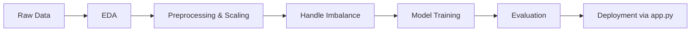

<div align="center">

# 💳 Credit Card Fraud Detection

### Machine learning model that spots fraudulent transactions in highly imbalanced data


[Overview](#-overview) • [Features](#-features) • [Dataset](#-dataset) • [Workflow](#-workflow) • [Results](#-results) • [Installation](#-installation) • [Usage](#-usage) • [Author](#-author)

</div>

---

## 📌 Overview

Credit card fraud costs the financial industry billions every year. The challenge: fraudulent transactions are **extremely rare** (well under 1% of all activity), so a naive model can look "99% accurate" while catching no fraud at all.

This project builds a complete fraud detection pipeline, from exploratory analysis and handling class imbalance to model training, evaluation with the right metrics, and an interactive app (`app.py`) for predictions.

## ✨ Features

- 🔍 **Exploratory Data Analysis** of transaction patterns and class distribution
- ⚖️ **Class imbalance handling** so the model actually learns what fraud looks like
- 🤖 **Model training and comparison** with fraud-appropriate metrics
- 📊 **Evaluation beyond accuracy**: Precision, Recall, F1-score, ROC-AUC, Confusion Matrix
- 🖥️ **Interactive app** (`app.py`) to test the model on transactions
- 📓 **Fully documented Jupyter Notebook** walking through every step

## 📂 Project Structure

```
Credit-Card-Fraud-Detection-Model/
│
├── 📓 Credit_Card_Fraud_Detection.ipynb   # Full analysis, training & evaluation
├── 🖥️ app.py                              # Application for fraud prediction
├── 📊 creditcard.csv                      # Transaction dataset
├── 📦 requirements.txt                    # Python dependencies
└── 📄 README.md
```

## 📊 Dataset

The dataset (`creditcard.csv`) contains anonymized credit card transactions.

| Feature | Description |
|---|---|
| `Time` | Seconds elapsed since the first transaction |
| `V1 – V28` | Anonymized features (PCA-transformed for confidentiality) |
| `Amount` | Transaction amount |
| `Class` | Target: `0` = Legitimate, `1` = Fraud |

> ⚠️ **Key challenge:** the fraud class is a tiny fraction of all transactions, which makes this a classic **imbalanced classification** problem.

## 🔄 Workflow



1. **Data Loading and Inspection**: check shape, nulls, and class balance
2. **EDA**: visualize distributions and fraud vs. legitimate behavior
3. **Preprocessing**: scale `Amount` and `Time`, split into train/test
4. **Imbalance Handling**: resampling / class weighting
5. **Modeling**: train and compare classifiers
6. **Evaluation**: focus on Recall, Precision, F1, and ROC-AUC
7. **Deployment**: serve predictions through `app.py`

## 📈 Results

> Replace the placeholders below with your actual notebook results.

| Model | Precision | Recall | F1-Score | ROC-AUC |
|---|---|---|---|---|
| Logistic Regression | `--` | `--` | `--` | `--` |
| Random Forest | `--` | `--` | `--` | `--` |
| Best Model | `--` | `--` | `--` | `--` |

**Why these metrics?** In fraud detection, **Recall** (catching real fraud) and **Precision** (avoiding false alarms) matter far more than plain accuracy.

<!-- Add screenshots here, e.g.:


-->

## ⚙️ Installation

**1. Clone the repository**
```bash
git clone https://github.com/tafrusaidev/Credit-Card-Fraud-Detection-Model.git
cd Credit-Card-Fraud-Detection-Model
```

**2. Create a virtual environment (recommended)**
```bash
python -m venv venv
source venv/bin/activate        # Windows: venv\Scripts\activate
```

**3. Install dependencies**
```bash
pip install -r requirements.txt
```

## 🚀 Usage

**Run the notebook**
```bash
jupyter notebook Credit_Card_Fraud_Detection.ipynb
```

**Launch the app**
```bash
streamlit run app.py
```
> If `app.py` is not a Streamlit app, run it with `python app.py` instead.

## 🛠️ Tech Stack

| Category | Tools |
|---|---|
| Language | Python |
| Data Processing | Pandas, NumPy |
| Machine Learning | scikit-learn |
| Visualization | Matplotlib, Seaborn |
| Environment | Jupyter Notebook |

## 🔮 Future Improvements

- [ ] Try advanced models (XGBoost, LightGBM, Neural Networks)
- [ ] Hyperparameter tuning with cross-validation
- [ ] Real-time prediction API (FastAPI / Flask)
- [ ] Model explainability with SHAP
- [ ] Deploy the app online

## 🤝 Contributing

Contributions, issues, and feature requests are welcome! Feel free to open an issue or submit a pull request.

## 👤 Author

**Tafrusai**
GitHub: [@tafrusaidev](https://github.com/tafrusaidev)

---

<div align="center">

⭐ **If you found this project useful, please give it a star!** ⭐

</div>
